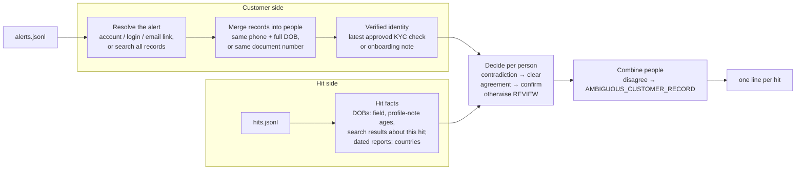

# Namesake: is the hit the customer?

For every screening hit, Namesake decides `DIFFERENT_ENTITY`, `SAME_ENTITY` or `REVIEW`. It gives one reason code, the customer record it resolved, a two-to-four-sentence reason and the IDs of the records that decided it. It applies the bank's identity SOP (`POLICY.md`) as deterministic rules, written in plain Python with no model calls.

```bash
system/run <data folder> <output file>          # e.g. system/run dev output/dev.jsonl
```

It reads only the data folder and writes one JSON line per hit. It needs Python 3.9+ and only the standard library.

| Development set (440 alerts, 819 hits, 72k customer records) | |
|---|---|
| Decisions | 463 `DIFFERENT_ENTITY`, 139 `SAME_ENTITY`, 217 `REVIEW` |
| Practice labels: decision / + reason code / customer record | 50/50, 50/50, 50/50 |
| Practice labels: evidence precision / recall | 1.00 / 1.00 |
| Practice labels: real matches cleared | 0 |
| Time per run | about 2 seconds on a laptop |
| Cost per run | $0 (no API calls) |

## Architecture



| Module | Role |
|---|---|
| `screening/data.py` | Loads the JSONL files (or the CSV browse export) and builds the join indexes |
| `screening/text.py` | Names (SOP 8): folding, variants, initials, placeholders, legal forms, edit distance. Also dates and countries |
| `screening/engine.py` | Customer resolution, hit facts, the decision rules, reasons and evidence |
| `run.py` | The CLI behind `system/run` |
| `evaluate.py` | Scores against `practice_labels.jsonl` and prints the path for any miss |
| `serve.py`, `ui/` | Optional analyst console. `run.py … --trace out/trace.json`, then `serve.py` |

## Finding the customer (SOP 2–4)

1. **Follow the link.** `account_ref` leads through accounts to customer records, `login_handle` through accounts, and `email` straight to customers. A joint account can lead to several records. The screened name, date of birth, country and city then pick the ones that fit.
2. **No link: search.** A name index that knows the variants finds candidates across all 72k records. A record fits when one of its full, preferred or login names agrees with the screened name, its date of birth equals the screened one in every part both give, and the screened country and city match its residence, nationality or address.
3. **One person, one picture.** Union-find joins records that share a phone number *and* the full date of birth, or a document number on an approved check, and anything linked to them in either way. A shared phone or address alone never merges records, because family members share both.
4. **Verified beats declared.** The latest approved check, from `kyc_checks.jsonl` or an onboarding note in the support tool, gives the legal name, date of birth and document country. Rejected and expired checks are ignored. The customer's countries are residence and nationality on every record, the document country, and places the notes say they lived. Each country keeps the IDs of the records it came from.
5. If several people fit, each is decided on its own. If they all lead to the same decision it stands. Otherwise the hit is `REVIEW` / `AMBIGUOUS_CUSTOMER_RECORD`. Either way `customer_record_id` is `AMBIGUOUS`.

## Finding the listed person (SOP 5)

- **Date of birth.** In order of preference: the `dobs` field; an age at a date in the first paragraph of the profile notes ("a 30-year-old" in November 1998 gives 1967 or 1968); or, only when neither exists, search results for the name. A search result is used only when it describes the hit's kind of listing ("a sanctioned individual", "a politically exposed person", …) in a country tied to the hit, because most results are about namesakes.
- **Earliest dated report**: only lines of the form `According to …; Month D, YYYY:`.
- **Countries**: `countries`, `nationality`, `citizenship`, the last part of each address, and `place_of_birth`. "International" and "Europe" don't count.
- **Date of death**, entity type, names and aliases. For companies, only `dobs` counts as an incorporation date.

## Deciding (SOP 6–8)

A hit is **cleared only on a contradiction**, checked in this order: entity type, death before screening, time (under 16 at the earliest report, using the oldest the customer could have been), every hit DOB contradicted, the verified legal name agreeing with none of the hit's names, and no shared country. A country difference never clears a person whose name and date of birth agree; that hit goes to `REVIEW`.

A hit is **confirmed only on agreement**: a person on name and date of birth, a company on name and country. Everything else is `REVIEW`. Unknown stays unknown: a missing field or a missing month or day is never a mismatch.

Two names agree when two parts match, or when every part of the shorter name matches. Parts match when they are identical, are listed together in `name_variants.json`, are written together or apart, or are within the SOP's edit distance. Placeholders such as `N/A` and `0000` are not name parts, so a customer left with one real part can be neither confirmed nor cleared on name.

## How evidence is represented

Every fact carries the IDs of the records it came from. Examples are the date of birth and its source, each country with its sources, the verified check, and the search results behind a hit's DOB. A decision cites only the sources of the facts that decided it:

- a clearance cites the contradicting facts;
- a confirmation cites the DOB source and the sources of the shared country;
- a review cites the facts that did agree.

`customer_record_id` is the resolved person's first record. The reason is built from the same facts, so the reason and the evidence always match.

## Keeping runs identical

There is no model, randomness, network or clock: "now" is the alert's `screened_at`. Files are read in sorted order, and sets are sorted before anything is printed from them. `system/run` also fixes `PYTHONHASHSEED`. Runs with different hash seeds, and on Python 3.9 and 3.15, give byte-identical output. The JSONL files and the CSV browse export also give identical output.

## Model and prompts

None. Every rule in the SOP is precise enough to code directly, and a model would add cost and run-to-run variation, which the scoring penalises. The free text (KYC notes, profile notes, search snippets) is parsed with general patterns: dates in any common format, ages at a date, the longest upper-case or capitalised run as a name. These patterns don't depend on this folder's exact sentences.

## Three cases

**A clear mismatch: H-13E1CF → `DIFFERENT_ENTITY` / `TEMPORAL_IMPOSSIBILITY`.** "Abdul Rahman YASIN" is screened with no date of birth. Account `ACC-B3E19A` leads to `CUS-364225`, and `CUS-851234` shares its phone and full date of birth, so both are one person. Approved check `KYC-358C76` verifies a birth date of 2007-08-21. The hit "Abdul Rahman" has no date of birth, but its profile says: *"According to the thenews.com.pk; January 08, 2020: … arrested for drug trafficking."* The customer was at most 13 at the time, under the SOP's 16, so this is a different person. Evidence: `KYC-358C76`, `CUS-851234`, `CUS-364225`.

**A match: H-582410 → `SAME_ENTITY` / `NAME_DOB_LOCATION_MATCH`.** "Elvira Velasco MORILLO", born 1968-03-05, is screened through account `ACC-C4CA34`. That account has two holders, and the screened date of birth picks `CUS-377745`. Onboarding note `NOTE-14E25A` records an approved check: ELVIRA VELASCO MORILLO, 1968-03-05, Spain. The hit has no DOB field, but its profile notes say *"November 1998 saw Elvira Velasco Morillo, a 30-year-old, face charges"*, which gives 1967 or 1968. Name, birth year and Spain all agree, and nothing contradicts them. Evidence: `CUS-377745`, `NOTE-14E25A`.

**Left for review: H-FA9F83 → `REVIEW` / `INSUFFICIENT_DATA`.** "Diana Cristian" is screened through account `ACC-08D260`, which leads to `CUS-783545`. Check `KYC-80B445` verifies DIANA CIRSTIAN, born 1961-02-02, a Moldovan document. "Cirstian" and "Cristian" are two edits apart (a swap), which is allowed for an 8-letter part, so the names agree, and both sides are linked to Moldova. But the hit gives no date of birth in its field, profile notes or matching search results. Nothing contradicts it, and a person can't be confirmed without a date of birth, so an analyst decides. The reason says exactly that: the missing fact is the hit's date of birth. Evidence: `CUS-783545`, `KYC-80B445`.

## What it doesn't do

- KYC notes are free text. If a note's wording hides the name or date of birth from the parser, the customer is compared on their unverified records instead.
- A hit's age written in a form the patterns don't recognise gives no date of birth, so the hit falls back to `REVIEW` rather than being cleared.
- Search results are used only when the hit has no other date of birth, and only results that match the listing kind and a country tied to the hit.

## Other commands

```bash
python3 system/evaluate.py dev              # practice-label score, with the path for every miss
python3 system/run.py dev output/dev.jsonl --trace out/trace.json --csv
python3 system/serve.py                     # analyst console on http://localhost:8000
```
